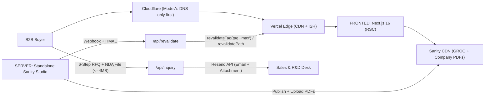

# Pet Supplement OEM/ODM Website — Consolidated Requirements & Development Plan (v2.1)

> **Project Positioning**: English-first B2B Pet Supplement OEM/ODM & Custom Formulation Lead-Generation Website (targeting pet brand owners, private-label buyers, and distributors — **not** a retail e-commerce store).
> **Visual Tone**: Warm, cartoon-playful, natural & editorial — cartoon illustrations confined to species/dosage cards and friendly mascot accents; hero, trust, and certification zones stay restrained for B2B credibility.
> **Repository Split**: `PetProj/FRONTED` (Next.js 16 Frontend) + `PetProj/SERVER` (Standalone Sanity CMS Studio & Schemas).
> **Tech Stack**: Next.js 16.x (App Router & RSC) · Tailwind CSS 4.x · TypeScript 5.x · Sanity CMS (Standalone in `SERVER/`) · next-sanity 12+ · Resend · Vercel · Cloudflare
> **Status**: Updated with v2 review fixes, FRONTED/SERVER split, dual file strategy (Sanity PDFs + Resend inquiry attachments), and full Technical SEO specification.

---

## 0. Change Log (v1 → v2 → v2.1)

| ID | Severity | Issue / Requirement | Resolution in v2.1 |
|---|---|---|---|
| 1 | **P0** | Silent fallback to seed data in production when `NEXT_PUBLIC_SANITY_PROJECT_ID` is missing | Seed data is **dev-only**; production build fails hard if `NEXT_PUBLIC_SANITY_PROJECT_ID` is unset. Visible `DEV SEED DATA` banner in dev mode (§1.4, §4) |
| 2 | **P0** | Human-supplement effects (`men's-health`, etc.) leaked into pet matrix | Replaced with **16 pet-specific effects** derived from pet catalog (3 × 5 × 16 = 240 cross pages) (§1.3) |
| 3 | **P0** | `next-sanity` `parseBody` & Next.js 16 `revalidateTag` API compatibility | Pinned `next` 16.x, `next-sanity` ≥12; `/api/revalidate` uses Next.js 16 two-argument `revalidateTag(tag, 'max')` (§1.4) |
| 4 | **P0** | Vercel 4.5 MB body limit & NDA confidentiality on inquiry file uploads | **Dual File Strategy**: (a) Company public PDFs/brochures/COAs managed in **Sanity CMS**; (b) Buyer NDA formula attachments sent via `/api/inquiry` → **Resend email attachments** (≤ 4 MB total, zero public URL exposure, never stored in Sanity) (§1.4) |
| 5 | **P1** | Frontend & Sanity Studio separation + root `layout.tsx` conflict | Split into **`PetProj/FRONTED`** (Next.js) and **`PetProj/SERVER`** (Standalone Sanity Studio). Eliminates `/studio` layout conflict and keeps frontend bundle lean (§2) |
| 6 | **P1** | Route conflict & dynamic route penetration | Unified `ingredients/page.tsx` + `[ingredient]/page.tsx` (no catch-all); strict allowlist + `notFound()` guard on `[slug]` and `[pet]/[form]/[effect]` (§1.5, §2) |
| 7 | **P1** | Product landing page count & thin pages | **68 categories → 65 shippable landing pages**; 3 zero-count items marked `status: "planned"` with no generated route (§1.3) |
| 8 | **P1** | Quote Box lost on refresh | `localStorage['pet-quote-box']` persistence + hydration + `/contact-us` prefill serialization (§1.4) |
| 9 | **P1** | Comprehensive SEO architecture required | Added dedicated **§1.5 Technical & Content SEO Architecture** (JSON-LD schemas, canonicals, breadcrumbs, heading hierarchy, crawl hygiene, Core Web Vitals) |
| 10 | **P2** | Compliance wording & `cankao.html` tokens | Strict AAFCO/FDA/NASC wording guardrails (§1.1); `cankao.html` design tokens **verified 100% against source file** (§1.2) |

---

## 1. Consolidated Requirements

### 1.1 Business & Conversion Funnel (`Prosafenutra_网站内容拆解.md`)
All pages serve one conversion goal: **build manufacturing trust → drive qualified B2B leads into the 6-section Inquiry Form (`/contact-us`)**.
- **Layer 1 — Capabilities**: Immediate visibility of the 5 core pet dosage forms (Chewable Tablets, Capsules, Powders, Drops, Pastes).
- **Layer 2 — Trust & Proof**: Why Choose Us, R&D / Quality Standards Trio (AI-assisted / vet-backed R&D, pharma-grade cGMP, global traceability), Facility & Capacity, Downloadable Company PDFs (Product Catalog, Facility Profile, Sample COA via Sanity), Certifications (**cGMP / ISO 22000 / HACCP; FDA-registered facility — never "FDA approved"**), Metrics Bar, Case Studies.
- **Layer 3 — Conversion Helpers**: Turnkey Private Label Catalog, Programmatic Custom Formulation Matrix (Species × Dosage Form × Effect), FAQ, Insights/Blog.
- **Layer 4 — Lead Capture**: Structured 6-section RFQ form collecting actionable quoting specs + formula file attachment.
- **Compliance language guardrail**: AAFCO is a model-regulation body — use "formulated to AAFCO nutrient profiles" **only where substantiation exists**; never "AAFCO certified". NASC may be described as membership "in progress" **only if actually true**; never imply certification.

### 1.2 Visual & Style Direction (`cankao.html` Verified — Cartoon, Lively & Natural)

> **Verified**: All color tokens and visual patterns below have been verified directly against `FRONTED/cankao.html`.

| Token | Value | Usage |
|---|---|---|
| Primary Accent (Amber Gold) | `#F5C443` / Hover `#EAB32A` / Highlight `#FCD34D` | Pill CTAs, active rings, badges, hero headline highlights |
| Natural Surfaces | Cream Ivory `#FAF8F4` / Warm Beige `#F5EED8` | Alternating page backgrounds, trust strip, featured blocks |
| Typography Ink | Deep Espresso `#1E1B16` / Warm Taupe `#6E6659` | Headings, body copy, muted captions |
| Borders | Soft Warm Hairline `#EAE3D2` | Elevated cards (`rounded-2xl` / `rounded-3xl`), inputs |
| Hero Studio Backdrop | Radial Amber-Bronze Studio Gradient | Hero & high-impact RFQ banner |
| Playful Pastel Card Fills | Slate `#D9E2EC`, Terracotta `#E7B596`, Mint `#D8EEDB`, Cream-Gold `#F5ECD5`, Ocean Teal `#5BB5C9`, Botanical Sage `#CBE3C8` | Species & 5 Dosage Form illustration cards **only** |
| Font | `Plus Jakarta Sans` (`next/font/google`, self-hosted) | Friendly geometric typography (zero external font latency) |

**Style adaptations from `cankao.html` to B2B OEM/ODM**:
- **Keep**: Transparent glass header on Hero, warm studio gradient, friendly 3D-shaded mascot ("Biscuit" & companion cat/small-pet SVGs) inside species/dosage cards and hero accent, tilted bone/paw accents, soft elevated cards, pill buttons, and the slide-over **Quote Shortlist Drawer** (repositioned from retail cart to B2B **Sample / Quote Box** that pre-fills `/contact-us`).
- **Adjust**: Replace retail unit-price countdowns with **Turnkey Formula Specs** (MOQ tiers, lead time, target species, active ingredients). Keep quality, compliance, and certification zones visually restrained so playful elements enhance brand warmth without undercutting B2B manufacturing credibility.

### 1.3 Information Architecture & Sitemap (`宠物补充剂定制网站_页面结构.md`)

Four parallel page systems (English-first `/`; explicit i18n migration path documented below):

| System | Routes | Priority | Count / Notes |
|---|---|---|---|
| **① Core Pages** | `/`, `/chewable-tablet-manufacturing`, `/capsule-manufacturing`, `/powder-manufacturing`, `/drops-manufacturing`, `/paste-manufacturing`, `/custom-formulation`, `/our-process`, `/contact-us` | **P0** | 9 pages — completes core conversion loop |
| **① Core Trust Pages** | `/quality-compliance`, `/our-facility`, `/about-us`, `/about-us/certifications`, `/faq`, `/privacy-policy` | **P1/P2** | 6 pages — authority, downloadable PDFs & compliance |
| **② Private Label Catalog** | `/private-label`, `/private-label/[form]` (5), `/private-label/[form]/[product]` | **P1 → P2** | 6 index pages (P1) + **65 shippable functional landing pages** (P2) |
| **③ Custom Formulation Matrix** | `/custom-formulation/ingredients`, `/ingredients/[ingredient]`, `/effects`, `/effects/[effect]`, `/by-pet`, `/by-pet/[pet]`, `/[pet]/[form]/[effect]` | **P2** | 3 species × 5 forms × **16 pet-specific effects = 240** controlled cross pages |
| **④ Insights (Blog)** | `/insights`, `/insights/[slug]` | **P2** | SEO education & category guides |

**Product landing page count** (derived from catalog spec):

| Dosage form | Categories | Zero-count excluded (`status: "planned"`) | Shippable landing pages |
|---|---:|---:|---:|
| Chewable tablets | 24 | 1 (`no-poo`) | 23 |
| Capsules | 5 | 0 | 5 |
| Powders | 18 | 1 (`tear-stain-powder`) | 17 |
| Drops | 17 | 1 (`anti-vomiting-drops`) | 16 |
| Pastes | 4 | 0 | 4 |
| **Total** | **68** | **3** | **65** |

> Zero-count items stay in Sanity with `status: "planned"` and **do not generate routes or sitemap entries** until real formulas exist.

**16 pet-specific effects**:
`joint-health` · `gut-health` · `skin-coat` · `immune-support` · `hairball-control` · `dental-oral-care` · `calming-stress` · `allergy-relief` · `urinary-kidney` · `respiratory-health` · `longevity-anti-aging` · `parasite-control` · `conditioning` · `eye-health` · `cognitive-health` · `reproductive-support`

**5 Dosage Forms & Technical Differentiation**:
1. **Chewable Tablets** (`chewable-tablet-manufacturing`): Palatability & flavor masking, cold-extrusion/compression hardness & friability.
2. **Capsules** (`capsule-manufacturing`): Shell materials (gelatin/HPMC/sprinkle-open), enteric protection, light-blocking packaging.
3. **Powders** (`powder-manufacturing`): Carriers, particle mesh/solubility, moisture control, kibble-topper acceptance.
4. **Drops / Liquids** (`drops-manufacturing`): Dropper/pump dosing precision, oil-phase homogenization, nitrogen flushing.
5. **Pastes / Gels** (`paste-manufacturing`): Emulsion stability, oil-separation prevention, tube filling & palatability.

**Future i18n Path**: Phase 1 ships English-only with no `[lang]` segment. When expanding to FR/DE/ES/JA, introduce a top-level `[lang]` segment in `FRONTED/src/app/`, add middleware for `/` → `/en/`, and output `alternates.languages` (`hreflang`) metadata.

---

### 1.4 Technical Architecture & Dual File Strategy



- **Dual File Handling**:
  1. **Company Public PDFs (Catalogs, Brochures, Facility Profiles, Sample COAs)**:
     - Uploaded by editors inside **`SERVER/` Sanity Studio** via a dedicated `companyDocument` schema (and optional `brochurePdf` file field on `dosageForm` / `product` / `page`).
     - Served directly from Sanity CDN (`cdn.sanity.io/files/...`) with clean download buttons (`?dl=filename.pdf`) on Homepage, Facility, Quality & Dosage Form pages.
  2. **Buyer Inquiry Attachments (Confidential Formula / Spec Sheets)**:
     - Submitted via `multipart/form-data` POST to `FRONTED/src/app/api/inquiry/route.ts`.
     - Validated server-side: MIME whitelist (`pdf, doc, docx, xlsx, csv`), max **3 files**, total payload **≤ 4 MB** (safely within Vercel's 4.5 MB serverless limit).
     - Forwarded directly as **Resend email attachments** to the sales/R&D inbox — **zero public URL exposure** and **never persisted in Sanity**, fully respecting B2B NDA expectations.
- **Rendering & Revalidation**:
  - Server Components by default; `generateStaticParams` for pre-rendering + `revalidate = 60` fallback + on-demand Sanity webhook revalidation.
  - `/api/revalidate` uses `next-sanity/webhook` (`parseBody` HMAC verification) and Next.js 16's two-argument `revalidateTag(tag, 'max')` alongside `revalidatePath(...)`.
- **Production-Safe Data Adapter**:
  ```ts
  const projectId = process.env.NEXT_PUBLIC_SANITY_PROJECT_ID
  if (!projectId && process.env.NODE_ENV === 'production') {
    throw new Error('NEXT_PUBLIC_SANITY_PROJECT_ID is required in production')
  }
  const useSeed = process.env.NODE_ENV !== 'production' && !projectId
  ```
  When `useSeed` is true in local development, render a visible `DEV SEED DATA` banner at the top of the page so mock content is never mistaken for production Sanity data.
- **Quote Box Persistence**:
  - `quote-context.tsx` hydrates from `localStorage['pet-quote-box']` on mount, persists on every mutation, stores `{ form, productSlug, label, moqTier }[]`, and auto-populates `/contact-us` (cleared only upon successful submission).
- **Pinned Versions**: `next` 16.x, `next-sanity` ≥12, `sanity` latest stable, `tailwindcss` 4.x, `typescript` 5.x, `resend` latest, `zod` latest. Exact versions locked via `package-lock.json`.

---

### 1.5 Technical & Content SEO Architecture

Designed from day one to rank for high-intent B2B keywords (*"pet supplement contract manufacturer"*, *"private label dog chewable tablets"*, *"custom cat probiotic powder OEM"*):

1. **URL Structure & Anti-Soft-404 Guardrails**:
   - Clean, lowercase, hyphenated URLs (`^[a-z0-9]+(?:-[a-z0-9]+)*$`), no query-param pagination for core categories, consistent non-trailing-slash policy.
   - Strict `notFound()` guards in `[slug]/page.tsx` and `custom-formulation/[pet]/[form]/[effect]/page.tsx` (validating against allowed species/forms/effects) so invalid URLs like `/custom-formulation/ingredients/foo/bar` always return HTTP 404.
   - Zero-SKU categories (`status: "planned"`) excluded from both routing and `sitemap.xml` to eliminate thin pages.
2. **Metadata & Canonical Strategy**:
   - Root `metadataBase` configured from `NEXT_PUBLIC_SITE_URL`.
   - Every page implements `generateMetadata()` with explicit `alternates.canonical`, `openGraph`, and `twitter` cards.
   - Sanity schema enforces `metaTitle <= 62` chars and `metaDescription <= 159` chars at publish time.
3. **Structured Data (JSON-LD via reusable `<JsonLd />` component)**:
   - **Global / Homepage**: `Organization` (logo, contactPoint, sameAs) + `WebSite`.
   - **All Inner Pages**: `BreadcrumbList` matching the exact visual breadcrumb trail.
   - **5 Dosage Form Pages**: `Service` (contract manufacturing serviceType, areaServed) + `FAQPage` (6 form-specific Q&As).
   - **65 Private Label Landing Pages**: `Product` (name, description, category, manufacturer — *omitting retail `Offer`/price* so Google does not misclassify as B2C e-commerce).
   - **FAQ Page & Homepage FAQ**: `FAQPage`.
   - **Insights Articles**: `Article` (headline, author, datePublished, dateModified, image).
4. **Semantic HTML & Internal Linking Graph**:
   - Strict single `<h1>` per page, logical `h1 → h2 → h3` outline, semantic landmarks (`<header>`, `<nav>`, `<main>`, `<article>`, `<footer>`), descriptive `alt` attributes.
   - Deliberate hub-and-spoke internal linking: Homepage → 5 Dosage Forms ↔ Sibling Dosage Forms → Private Label Catalog → 65 Functional Pages ↔ Related Products; Matrix pages ↔ Relevant Dosage Form & Private Label pages; Insights → Relevant Product/Form pages; **All pages → `/contact-us`**.
5. **Crawlability & Core Web Vitals**:
   - Dynamic `sitemap.ts` (including `lastModified`, `changeFrequency`, `priority` tiered by P0/P1/P2) and `robots.ts` (pointing to sitemap, blocking `/api/`).
   - RSC-first architecture (minimal client JS), self-hosted `Plus Jakarta Sans` (`next/font`), `next/image` with `cdn.sanity.io` `remotePatterns` + explicit aspect ratios (zero CLS).

---

## 2. Project Directory Structure (`PetProj` Root)

Existing reference docs in `PetProj/FRONTED/` are kept untouched (or archived into `FRONTED/docs/` if preferred).

```text
PetProj/
├── FRONTED/                                     # Next.js 16 Frontend App (Deploy to Vercel)
│   ├── next.config.ts                           # images.remotePatterns (cdn.sanity.io)
│   ├── package.json
│   ├── .env.local.example
│   └── src/
│       ├── app/
│       │   ├── layout.tsx                       # Root HTML, Plus Jakarta Sans, Organization JSON-LD, Header, Footer, QuoteBoxProvider
│       │   ├── globals.css                      # Tailwind 4 theme tokens (cankao.html palette)
│       │   ├── page.tsx                         # Homepage (/)
│       │   ├── contact-us/page.tsx              # 6-Section Structured RFQ Inquiry Form
│       │   ├── our-process/page.tsx             # 5-Step Custom Manufacturing Process
│       │   ├── quality-compliance/page.tsx      # Quality, cGMP, COA, AAFCO/EU feed-compliance + PDF Downloads
│       │   ├── our-facility/page.tsx            # Facility, Equipment, MOQ & Lead Times + Facility PDF
│       │   ├── about-us/
│       │   │   ├── page.tsx                     # About Us
│       │   │   └── certifications/page.tsx      # Certifications & Lab Testing
│       │   ├── faq/page.tsx                     # B2B Procurement FAQ (+ FAQPage JSON-LD)
│       │   ├── privacy-policy/page.tsx          # Privacy Policy
│       │   ├── [slug]/page.tsx                  # 5 Dosage Form Manufacturing Pages (strict allowlist + notFound)
│       │   ├── private-label/
│       │   │   ├── page.tsx                     # Private Label Overview
│       │   │   └── [form]/
│       │   │       ├── page.tsx                 # Dosage Form Catalog
│       │   │       └── [product]/page.tsx       # 65 Functional Product Landing Pages
│       │   ├── custom-formulation/
│       │   │   ├── page.tsx                     # Custom Formulation Overview
│       │   │   ├── ingredients/
│       │   │   │   ├── page.tsx                 # Ingredient Index
│       │   │   │   └── [ingredient]/page.tsx
│       │   │   ├── effects/
│       │   │   │   ├── page.tsx                 # 16 Pet Effects Index
│       │   │   │   └── [effect]/page.tsx
│       │   │   ├── by-pet/
│       │   │   │   ├── page.tsx                 # Species Index (Dogs / Cats / Small Pets)
│       │   │   │   └── [pet]/page.tsx
│       │   │   └── [pet]/[form]/[effect]/page.tsx # 240 Controlled Cross Pages (strict allowlist + notFound)
│       │   ├── insights/
│       │   │   ├── page.tsx                     # Insights List
│       │   │   └── [slug]/page.tsx              # Article Detail (+ Article JSON-LD)
│       │   ├── api/
│       │   │   ├── revalidate/route.ts          # Sanity Webhook (parseBody HMAC + revalidateTag(tag, 'max'))
│       │   │   └── inquiry/route.ts             # RFQ Handler (Zod + <=4MB attachment check + Resend)
│       │   ├── sitemap.ts                       # Auto-generated XML sitemap
│       │   └── robots.ts                        # robots.txt
│       ├── components/
│       │   ├── seo/                             # JsonLd.tsx, Breadcrumbs.tsx
│       │   ├── layout/                          # Header, MobileMenu, Footer, QuoteBoxDrawer, DevSeedBanner
│       │   ├── illustrations/                   # Mascot (Biscuit Dog, Cat, Small Pet) & 5 Dosage Form SVGs
│       │   ├── sections/                        # Hero, TrustStrip, DosageFormGrid, TurnkeyShowcase,
│       │   │                                    # WhyChooseUs, ProcessSteps, SpecTable, QualityTrio,
│       │   │                                    # CertificationsBar, PdfDownloads, CaseStudies,
│       │   │                                    # FAQAccordion, RelatedLinks, CTABanner
│       │   └── forms/InquiryForm.tsx            # 6-Section conditional RFQ form + file upload ('use client')
│       └── lib/
│           ├── sanity/                          # client.ts, queries.ts, image.ts, file.ts (PDF URL helper)
│           ├── data/                            # Production-safe adapter + dev-only local seed data
│           │   ├── index.ts                     # Env guard (prod throws if Sanity missing; dev uses seed)
│           │   ├── dosageForms.ts               # 5 dosage forms, specs, 6 FAQs each
│           │   ├── products.ts                  # 68 categories (65 shippable, 3 status:"planned")
│           │   ├── formulationMatrix.ts         # 3 species, 8 ingredient categories, 16 pet effects
│           │   ├── documents.ts                 # Sample company PDF brochure/COA metadata
│           │   └── insights.ts                  # Initial SEO articles
│           └── quote-context.tsx                # Client context + localStorage persistence + prefill
│
└── SERVER/                                      # Standalone Sanity CMS Studio (Deploy via `sanity deploy`)
    ├── sanity.config.ts
    ├── sanity.cli.ts
    ├── package.json
    ├── .env.example
    ├── schemaTypes/
    │   ├── index.ts
    │   ├── page.ts                              # Core CMS pages + SEO limits
    │   ├── dosageForm.ts                        # 5 dosage forms + PDF spec sheet + FAQs
    │   ├── product.ts                           # Private label products (`status: active | planned`) + PDF
    │   ├── ingredient.ts                        # 8 ingredient categories / items
    │   ├── effect.ts                            # 16 pet-specific effects
    │   ├── pet.ts                               # Dogs / Cats / Small Pets
    │   ├── companyDocument.ts                   # Company PDFs (Catalogs, Facility Profile, Sample COAs)
    │   └── article.ts                           # Insights / Blog (Portable Text + SEO)
    └── scripts/
        └── seed.ts                              # Optional CLI script to import initial English data into Sanity
```

---

## 3. Environment Variables

### `FRONTED/.env.local` (and Vercel Project Settings)
```env
NEXT_PUBLIC_SITE_URL=https://your-domain.com
NEXT_PUBLIC_SANITY_PROJECT_ID=
NEXT_PUBLIC_SANITY_DATASET=production
NEXT_PUBLIC_SANITY_API_VERSION=2026-11-23
SANITY_REVALIDATE_SECRET=
SANITY_API_READ_TOKEN=

# Inquiry email delivery (Resend)
RESEND_API_KEY=
INQUIRY_TO_EMAIL=sales@your-domain.com
INQUIRY_FROM_EMAIL=noreply@your-domain.com

# Optional anti-spam
NEXT_PUBLIC_TURNSTILE_SITE_KEY=
TURNSTILE_SECRET_KEY=
```

### `SERVER/.env`
```env
SANITY_STUDIO_PROJECT_ID=
SANITY_STUDIO_DATASET=production
```

---

## 4. Phased Implementation Roadmap

### Phase 1 — Foundation, Dual-Folder Setup & P0 Conversion Loop
1. **Scaffold `SERVER/` (Standalone Sanity Studio)**: Initialize Sanity project, author all 8 schemas (`page`, `dosageForm`, `product`, `ingredient`, `effect`, `pet`, `companyDocument`, `article`) with strict slug regex & SEO length validation (`metaTitle <= 62`, `metaDescription <= 159`), plus seed script.
2. **Scaffold `FRONTED/` (Next.js 16 + TypeScript 5 + Tailwind 4)**: Configure `Plus Jakarta Sans` (`next/font`), verified `cankao.html` design tokens, cartoon SVGs (mascot + 5 dosage forms + species), `<JsonLd />` & `<Breadcrumbs />` SEO components.
3. **Data Layer & Global Layout**: Production-safe Sanity client + dev-only seed fallback with `DEV SEED DATA` banner; Header, Footer, and `localStorage`-persisted Quote Box Drawer.
4. **P0 Pages**:
   - Homepage (`/`) with full B2B conversion funnel & PDF brochure download entry.
   - 5 Dosage Form Manufacturing pages (`/[slug]`) using the unified 10-section template + `Service` & `FAQPage` JSON-LD.
   - `/custom-formulation`, `/our-process`.
   - `/contact-us` with 6-section conditional RFQ form, ≤ 4 MB NDA file attachment, and Quote Box prefill.
5. **APIs & SEO**: `/api/revalidate` (`parseBody` + `revalidateTag(tag, 'max')`), `/api/inquiry` (Zod + Resend with attachments), `sitemap.ts`, `robots.ts`, `next.config.ts`.

### Phase 2 — P1 Trust Pages & Private Label Directory
1. **Trust & Compliance Pages**: `/quality-compliance`, `/our-facility`, `/about-us`, `/about-us/certifications`, `/faq`, `/privacy-policy` — with compliance guardrails and Sanity PDF downloads.
2. **Private Label Directory**: `/private-label` overview + 5 form catalog pages with species/function filtering.

### Phase 3 — P2 Programmatic SEO & Content Center
1. **65 Functional Product Landing Pages** (`/private-label/[form]/[product]`) with `Product` JSON-LD (no retail price), specs, packaging, MOQ/lead time, and Quote Box integration. Three `status: "planned"` categories excluded.
2. **Custom Formulation Matrix**: `/ingredients`, `/effects`, `/by-pet` indexes + detail pages + **240 controlled cross pages** (`/custom-formulation/[pet]/[form]/[effect]`) with strict `notFound()` guardrails.
3. **Insights Center**: `/insights` & `/insights/[slug]` with `Article` JSON-LD and initial English B2B articles.

### Phase 4 — Deployment & Verification
1. Run all §5 verification checks locally.
2. Deploy `SERVER/` via `sanity deploy` and configure Webhook → `https://<domain>/api/revalidate`.
3. Deploy `FRONTED/` to Vercel + Cloudflare **Mode A (DNS-only)** first; enable Mode B (proxied) only with Cache Rules bypassing `/api/*` and HTML.

---

## 5. Verification Plan

- **Build & Type Safety**: `npx tsc --noEmit` and `npm run build` pass in `FRONTED/`; Sanity schema build/validation passes in `SERVER/`.
- **Production Config Negative Test (P0)**: Build `FRONTED/` in production mode without `NEXT_PUBLIC_SANITY_PROJECT_ID` → build **must fail**. With valid config, spot-check rendered HTML to verify `DEV SEED DATA` banner is absent.
- **Visual, Responsive & Interactive QA**: Inspect `/`, `/chewable-tablet-manufacturing`, `/private-label`, `/contact-us` in browser; verify cartoon/natural aesthetics, Quote Box `localStorage` persistence across refresh → `/contact-us` prefill, 6-section conditional fields, and ≤ 4 MB file attachment validation.
- **SEO Audit**: Validate `/sitemap.xml` (no planned/zero-SKU URLs), `/robots.txt`, canonical tags, metadata lengths (`title <= 62`, `description <= 159`), JSON-LD structured data (`Organization`, `BreadcrumbList`, `Service`, `Product`, `FAQPage`, `Article`), single `<h1>` per page, and 404 behavior on invalid matrix/slug URLs.
- **Webhook & API Negative Tests**: Forged POST to `/api/revalidate` returns **401**; oversized (> 4 MB) or invalid MIME upload to `/api/inquiry` returns **400**; valid submission delivers email + attachment via Resend.
- **Cloudflare Check (Mode B)**: Confirm `/api/*` and HTML bypass edge cache so Sanity publishes reflect immediately via ISR.
